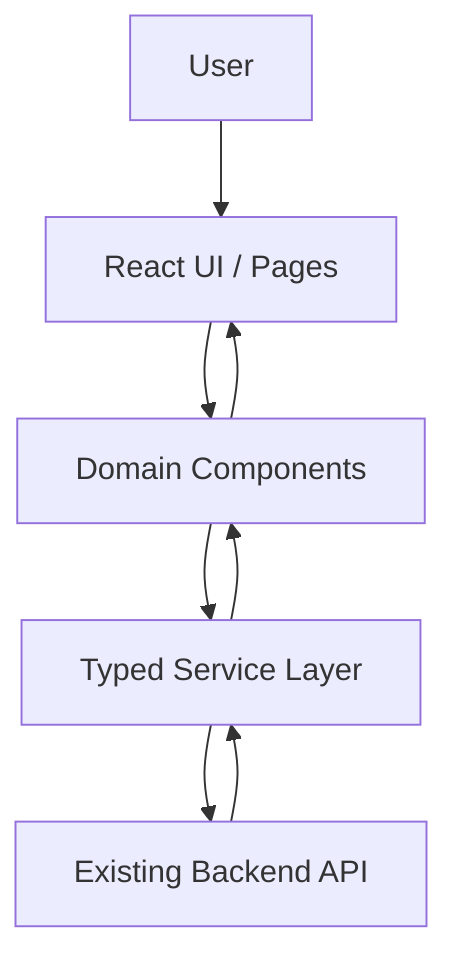

# Axiom — Architecture

## Purpose
Document the architecture that actually exists. This file begins with the intended boundaries and must be updated after repository inspection; do not treat proposed structure as proof of implementation.

## Architectural Principles
- Preserve the current stack and working infrastructure unless there is a clear reason to change it.
- Keep presentation, domain types, and API access separated.
- Use shared layouts and reusable UI primitives.
- Keep backend-dependent behavior behind typed service interfaces.
- Separate mock/development data from real production integrations.
- Validate external data and handle loading, empty, success, and failure states.
- Keep private credentials and server-only configuration out of browser code.

## Intended Frontend Boundaries
Adapt these boundaries to the existing project; do not force a rewrite to match them.

- **Application/bootstrap:** entry point, providers, route setup, global error handling.
- **Layouts:** public layout and authenticated application shell.
- **Pages:** the eight canonical Axiom screens.
- **Shared UI:** buttons, inputs, badges, cards, dialogs, loading states, and empty states.
- **Contract domain components:** upload, document list, risk summary, findings, clause viewer, comparison.
- **Services:** centralized API client and domain-specific contract/analysis calls.
- **Types/schemas:** contract, document, analysis, finding, and report models.
- **Styles:** design tokens, global styles, responsive rules.

## Intended Request/Data Flow

This is a conceptual diagram. Modify it if the actual repository uses a different architecture.

## Backend Integration Rules
1. Inspect API documentation, backend routes, and schemas before making requests.
2. Use actual endpoints and response shapes; do not guess endpoint paths.
3. Centralize base URL and request/error handling.
4. Document authentication and credential handling based on the actual implementation.
5. Represent long-running analysis using the backend's real job/status model.
6. If the backend is missing or unavailable, isolate mock services behind the same interface and label mock mode clearly.

## Environment and Configuration
- Frontend public environment variables may be exposed to the browser. In Vite, `VITE_*` values are public; never place secrets there.
- Backend secrets belong only in server-side environment configuration.
- Commit `.env.example`, not real `.env` files.
- Use `.venv` only if Python backend/tooling exists.
- Keep lockfiles and dependency definitions consistent with the selected package manager.

## Security and Reliability
- Validate file type and size on both client and server when uploads exist.
- Do not trust client-side validation as a security boundary.
- Avoid logging contract contents, credentials, or other sensitive data unnecessarily.
- Handle network failures, expired sessions, invalid identifiers, and unavailable services.
- Do not claim authentication, persistence, or access controls work unless verified.

## Repository-Specific Facts (Verified)
- **Frontend Stack:** React 19.3.1, TypeScript 6.0.3, Vite 8.3.5, npm, Tailwind CSS v4.3.3 (@tailwindcss/vite), Motion 14.5.0, Lucide React 1.61.0.
- **Backend Status:** No live backend server is running in the repository. The application operates in high-fidelity mock mode (`VITE_USE_MOCK_DATA=true`) via `src/services/contractService.ts`.
- **Application Entry Points:**
  - `index.html` → `src/main.tsx` → `src/App.tsx`.
- **Route Map (Hash-based routing with deep-link support):**
  - `#/landing` — Public landing page (features, live demo, FAQ, trust guarantees).
  - `#/dashboard` — Contract intelligence workspace (telemetry, quick actions, recent documents).
  - `#/analyze` — Document upload & staged enclave analysis simulation.
  - `#/results?doc=<id>` — 3-column analysis workspace (clause list, document viewer, clause detail & redlines).
  - `#/report?doc=<id>` — Printable and downloadable executive analysis report.
  - `#/compare` — Side-by-side legal diffing and counter-proposal review.
  - `#/history` — Searchable contract audit repository.
  - `#/settings` — Preferences, liability threshold calibration, and retention settings.
- **API Base URL Configuration:** `VITE_API_BASE_URL` (default: `http://localhost:8000`), managed centrally by `src/config/env.ts`.
- **Authentication / Session Strategy:** Frontend user profile state initialized in `src/data/sampleContracts.ts` and managed via `ContractService`.
- **Data Persistence:** In-memory reactive state in `ContractService` supporting runtime document additions and clause review status toggling.
- **Verification Commands:**
  - Lint: `npm run lint` (`oxlint` — 0 errors, 0 warnings)
  - Tests: `npm test` (`vitest run` — 8 passing tests)
  - Build: `npm run build` (`tsc -b && vite build`)
  - Dev Server: `npm run dev` (`http://localhost:5173/`)
- **Key Architectural Decisions:**
  - ADR 0001: Established centralized documentation and memory tracking.
  - Isolated Service Layer: All domain actions route through `contractService` so switching from mock mode to live REST/FastAPI endpoints requires zero UI component refactoring.
