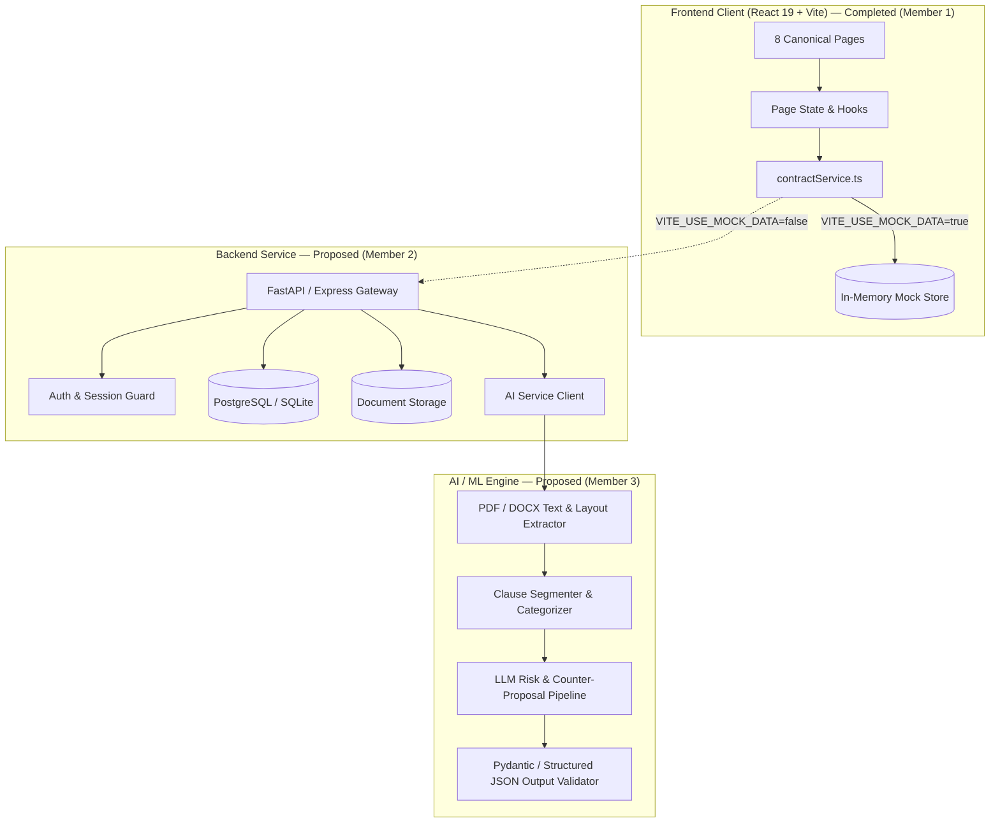

# Axiom — Technical Architecture

> Authoritative architectural specification for the Axiom Contract Intelligence Platform.
> Clearly distinguishes existing verified implementation from proposed future modules.

---

## 1. System Overview & Macro Architecture

Axiom is structured as a decoupled contract intelligence application designed for collaborative multi-member development:

---

## 2. Existing Frontend Architecture (Verified & Completed)

The frontend is a single-page application built on React 19 and Vite 8, utilizing hash-based routing with deep-link query parameter support (`#/<route>?doc=<id>`).

### Directory Structure & Responsibilities
- **`src/pages/`**: The eight canonical user experiences:
  1. `LandingPage.tsx`: Public marketing experience, interactive live clause preview, trust badges, and FAQ accordion.
  2. `DashboardPage.tsx`: Contract intelligence workspace, activity telemetry, primary action cards, and recent documents.
  3. `AnalyzePage.tsx`: Contract upload dropzone with 4-stage enclave analysis progress simulation.
  4. `AnalysisResultsPage.tsx`: 3-column workspace with risk filters, highlighted document viewer, and plain-English clause breakdown.
  5. `ReportPage.tsx`: Printable executive summary audit sheet with PDF export.
  6. `ComparePage.tsx`: Side-by-side legal diffing tool distinguishing insertions, deletions, and contractual conflicts.
  7. `HistoryPage.tsx`: Searchable contract audit repository with severity counters and review filters.
  8. `SettingsPage.tsx`: Preferences for liability calibration, analysis tone, and data retention policies.
- **`src/components/layout/`**: Application shell (`AppHeader.tsx`, `Sidebar.tsx`, `Navbar.tsx`, `Footer.tsx`).
- **`src/components/ui/`**: Hardware-inspired tactile design primitives (`DoubleBezel.tsx`, `Button.tsx`, `RiskBadge.tsx`).
- **`src/components/contracts/`**: Contract domain modals (`TemplatesModal.tsx`).
- **`src/services/`**: Centralized service abstraction (`contractService.ts` and unit tests `contractService.test.ts`).
- **`src/types/`**: Strict TypeScript interfaces (`contract.ts`).
- **`src/config/`**: Public runtime configuration (`env.ts` and test suite `env.test.ts`).
- **`src/data/`**: Benchmark sample contracts, initial fixtures, and counter-proposals (`sampleContracts.ts`).

### Data Flow within the Frontend
1. The user triggers an action (e.g. upload document or select clause).
2. The UI component invokes a method on the singleton `contractService`.
3. If `VITE_USE_MOCK_DATA=true` (current state), `contractService` simulates network latency and returns typed sample fixtures from `src/data/sampleContracts.ts`.
4. If `VITE_USE_MOCK_DATA=false`, `contractService` issues authenticated HTTP requests to `VITE_API_BASE_URL`.
5. The UI component renders deterministic states: `loading`, `empty`, `error`, or `success`.

---

## 3. Backend Architecture (Member 2 Domain — Completed & Verified)

*Status: Implemented & Verified with 21 passing automated unit and integration tests.*

The production-ready backend resides in the `backend/` directory:
- **Framework:** FastAPI (Python 3.11–3.14 compatible), Uvicorn server, Pydantic v2 validation.
- **Persistence:** Relational database with PostgreSQL 16 (and SQLite for fast ephemeral tests), SQLAlchemy 2.0 ORM, and Alembic schema migrations.
- **Data Models:**
  - `User`: User profile, credentials (Argon2id hash), risk threshold preferences, and retention days.
  - `Document`: Contract document metadata, ownership, SHA-256 checksum, opaque storage key, status (`uploaded`, `processing`, `needs_review`, `completed`, `failed`), extracted text, and timestamps.
  - `Analysis`: Versioned analysis record, schema version, risk count totals, and structured JSON results.
  - `ClauseFinding`: Flagged clauses with risk severity (`high`, `medium`, `low`, `info`), verbatim original text, plain-English commercial explanations, balanced redline counter-proposals, and review/bookmark tags.
- **Storage Service:** Opaque private storage with path traversal defense (`../` attack prevention) storing raw contract files outside the public web root.
- **Text Extraction:** Multi-format extractor supporting `.pdf` (`pypdf`) and `.docx` (`python-docx`).
- **Core Endpoints:** Fully aligned with `docs/API.md` and frontend `src/services/contractService.ts`:
  - `GET /api/v1/health` — Service liveness and database connection readiness.
  - `POST /api/v1/auth/register` & `POST /api/v1/auth/login` — Account creation and JWT authentication.
  - `GET /api/v1/me` — Authenticated identity retrieval.
  - `POST /api/v1/documents/upload` (and alias `POST /api/v1/documents`) — Multipart file upload (PDF/DOCX <= 25 MB).
  - `POST /api/v1/documents/{id}/analyze` (and alias `POST /api/v1/documents/{id}/reanalyze`) — Risk scoring and redline synthesis.
  - `GET /api/v1/documents/{id}` — Full contract document with clauses and findings.
  - `GET /api/v1/documents/{id}/analysis` — Structured analysis JSON.
  - `GET /api/v1/documents` — User document listing with pagination and status filters.
  - `PATCH /api/v1/documents/{id}/clauses/{clauseId}` — Clause reviewed/bookmarked toggle.
  - `POST /api/v1/documents/compare` — Legal diff comparison.
  - `GET /api/v1/user/profile` & `PUT /api/v1/user/profile` — User profile preferences.
  - `DELETE /api/v1/documents/{id}` — Permanent document and storage deletion.
- **Security:** Strict cross-user ownership isolation, Argon2id password hashing, JWT bearer auth (with local demo user fallback in development mode), Request-ID tracing, and no-leak standardized error envelopes.

---

## 4. Proposed AI / ML Pipeline Architecture (Member 3 Domain)

*Status: Architecture Proposed — Implementation Pending.*

The proposed intelligence module will reside in a dedicated `ai/` directory:
- **Document Ingestion:** Extract raw text, section numbers, and page anchors using `PyMuPDF` / `pdfplumber` (for PDF) and `python-docx` (for DOCX).
- **Clause Segmentation:** Chunk document into distinct legal clauses preserving section headers (e.g., `Section 9.1 • Indemnification`).
- **Analysis & Risk Scoring:**
  - Classify clauses into risk levels: `high`, `medium`, `low`, `info`.
  - Benchmark against independent professional standards (detecting uncapped liability, pre-existing IP transfer, unilateral non-competes).
  - Generate plain-English explanations highlighting commercial risk.
  - Synthesize balanced redline counter-proposals (e.g., capping contractor liability at fees paid).
- **Structured Output Guarantee:** Enforce JSON schema validation via Pydantic or Instructor to prevent hallucinated structures.
- **Diff Engine:** Compare source and revised contract text, distinguishing textual formatting from true contractual conflicts.

---

## 5. Architectural Decision Records (ADRs)

- [ADR 0001: Establish Project Knowledge Files](file:///Users/kunalsuryanshi/Documents/axiom/docs/decisions/0001-project-documentation.md) — Established `MEMORY.md`, `CONTEXT.md`, `ARCHITECTURE.md`, `DESIGN.md`, and `AGENTS.md` as foundational sources of truth.
- [ADR 0002: Three-Member Decoupled Architecture](file:///Users/kunalsuryanshi/Documents/axiom/docs/decisions/0002-three-member-architecture.md) — Decoupled Frontend (Member 1), Backend API (Member 2), and AI Engine (Member 3) behind typed interfaces.

---

## 6. Open Architectural Questions

1. **Analysis Execution Model:** Should long-running contract analysis be handled via polling (`POST /analyze` returns `jobId` -> `GET /jobs/{id}`) or Server-Sent Events (SSE) streaming?
2. **File Storage Policy:** Should uploaded contracts be stored on local filesystem storage in development, or use S3-compatible object storage?
3. **AI LLM Provider:** Gemini 1.5 Pro / Flash vs Claude 3.5 Sonnet vs OpenAI GPT-4o for legal reasoning and structured extraction.
